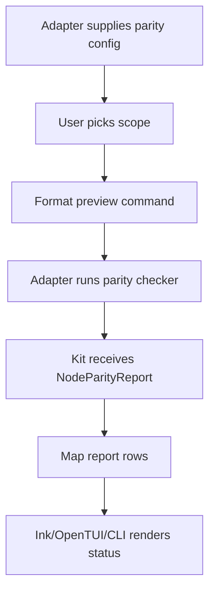

# @gg-utils/node-version-kit

Reusable Node version parity contracts, command-preview helpers, report-row helpers, and Ink/OpenTUI
terminal shells.

Use this package when a repository wants to compare a canonical Node version contract against
multiple surfaces such as `.nvmrc`, `package.json`, deploy config, runtime metadata, or hosted
project settings.

## Install

```bash
npm install @gg-utils/node-version-kit@git+https://github.com/gg-utils/node-version-kit.git#main
```

Pinned dependency example:

```json
{
  "dependencies": {
    "@gg-utils/node-version-kit": "git+https://github.com/gg-utils/node-version-kit.git#49c102e"
  }
}
```

## When To Use

- You need shared report contracts for Node parity checks.
- You need formatted command previews for `npx tsx` parity scripts.
- You need reusable row rendering for aligned/mismatch/missing/inactive surfaces.
- You need Ink or OpenTUI shells driven by injected project config and check runners.

## Public Surfaces

| Import | Purpose |
|---|---|
| `@gg-utils/node-version-kit/contracts` | Parity report, scope, surface, and UI config types. |
| `@gg-utils/node-version-kit/format-commands` | Pure command preview formatting. |
| `@gg-utils/node-version-kit/report-rows` | Display-row helpers for reports. |
| `@gg-utils/node-version-kit/ink-app` | Reusable Ink parity UI. |
| `@gg-utils/node-version-kit/opentui-app` | Reusable OpenTUI parity UI. |

## Quick Start

```ts
import {
  NodeVersionKit_formatNpxCheckParityCommand,
  type NodeVersionKit_NodeParityReport,
} from "@gg-utils/node-version-kit";

const command = NodeVersionKit_formatNpxCheckParityCommand({
  checkParityScriptPath: "scripts/node-version/check-parity.ts",
  json: true,
  scope: "static",
});

function isAligned(report: NodeVersionKit_NodeParityReport): boolean {
  return report.ok && report.exitCode === 0;
}

console.log(command);
```

## Operational Flow



## Development

```bash
git clone https://github.com/gg-utils/node-version-kit.git
cd node-version-kit
npm run type-check
npm test
npm run build
```

Scripts currently expect the source-first workspace toolchain.

## Layout

```text
.
|-- src/contracts.ts
|-- src/format-commands.ts
|-- src/report-rows.ts
|-- src/ink-app.tsx
|-- src/opentui-app.tsx
|-- dist/
`-- package.json
```

## Caveats

- The package does not discover version surfaces on its own; adapters provide definitions.
- It does not execute parity checks unless an adapter injects a runner into the UI.
- Command helpers are pure string formatters.

## Use from another repository

Add this dependency to your `package.json` and install normally; compiled ESM and declarations are included in the tag, with no consumer build step.

```json
"@gg-utils/node-version-kit": "git+https://github.com/gg-utils/node-version-kit.git#v0.2.0"
```

Requires Node `>=22.0.0 <27` (Node 22, 24, and 26).

Terminal components use React 19 and Ink 6. The OpenTUI component uses a scoped JSX runtime that forwards React's JSX functions, keeping terminal element types separate from DOM types. The compiled runtime and its declarations are included in `dist/`.
